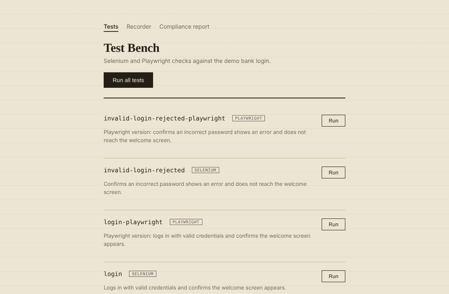

# Bank Login Test Bench


An end-to-end test automation suite for a demo bank login flow, built with **both Selenium WebDriver and Playwright**. It has two ways to run:

1. **A web dashboard** (Express + vanilla JS) that runs Selenium and Playwright tests side by side with one click and streams each test's steps live.
2. **A Playwright Test suite** using the Page Object Model, run cross-browser (Chromium, Firefox, WebKit) locally and in **GitHub Actions CI**, with HTML reports, traces, screenshots, and video on failure.
3. **API tests** for the dashboard's REST API: status codes, JSON Schema contract validation, NDJSON streaming, and malicious-input handling. They run first in CI.

> ⚠️ This project targets a **demo bank only**. It is not intended for, and should never be pointed at, a real banking site or real account.



---

## Table of Contents

- [Features](#features)
- [How It Works](#how-it-works)
- [Tech Stack](#tech-stack)
- [Getting Started](#getting-started)
- [Configuration](#configuration)
- [Using the Dashboard](#using-the-dashboard)
- [Playwright Test Suite](#playwright-test-suite)
- [API Tests](#api-tests)
- [Continuous Integration](#continuous-integration)
- [Running with Docker](#running-with-docker)
- [Writing a New Test](#writing-a-new-test)
- [Project Structure](#project-structure)
- [Deploying Publicly](#deploying-publicly)
- [Troubleshooting](#troubleshooting)

---

## Features

- **Two automation frameworks** — the same login scenarios implemented in Selenium WebDriver and Playwright, labeled by engine in the dashboard for side-by-side comparison.
- **One-click test runs** — run any test individually, or the full suite with **Run all tests**.
- **Live step logs** — each test streams its steps to the dashboard as it runs (NDJSON over HTTP), then reports pass/fail, message, and duration.
- **Page Object Model** — Playwright tests interact with the page through `playwright/pages/LoginPage.js`.
- **Cross-browser** — the Playwright suite runs on Chromium, Firefox, and WebKit.
- **API testing** — Playwright `request` tests validate the dashboard's REST API against JSON Schemas (Ajv), including negative and security-focused cases.
- **CI/CD** — GitHub Actions runs API tests, then UI tests, on every push and pull request, and uploads both HTML reports.
- **Failure artifacts** — traces, screenshots, and video are kept automatically when a Playwright test fails.
- **Auto-discovered tests** — any `*.test.js` file in `/tests` appears in the dashboard automatically. No registration or wiring.
- **Shared driver and selectors** — one WebDriver builder (`lib/driver.js`), one Playwright launcher (`lib/pw-browser.js`), and one locator map per framework, so a UI change on the bank page is fixed in one place.
- **Dockerized** — one image runs the dashboard with both engines against the system Chromium.
- **Headless or headed** — toggle with a single env variable: watch the browser locally, run headless on a server.
- **Config through environment variables** — no credentials in source code.

## How It Works

```
┌──────────────┐   HTTP    ┌──────────────┐  WebDriver/ ┌──────────────┐
│  Dashboard   │ ────────▶ │ Express API  │ Playwright▶ │   Chrome     │
│ (public/)    │ ◀──────── │ (server.js)  │ ◀────────── │ → Demo bank  │
└──────────────┘  results  └──────────────┘             └──────────────┘
                                  │
                                  ▼
                          tests/*.test.js
        (Selenium: lib/driver + lib/selectors,
         Playwright: lib/pw-browser + LoginPage)
```

1. The dashboard loads the list of tests discovered in `/tests`.
2. Clicking **Run** asks the Express server to execute that test.
3. The test opens Chrome through Selenium or Playwright, drives the demo bank's login page, and returns a message on success or throws an error on failure.
4. Each step is streamed back to the dashboard as it happens, followed by the final result and duration.

## Tech Stack

| Layer           | Tool                                                                  |
| --------------- | --------------------------------------------------------------------- |
| Test automation | [selenium-webdriver](https://www.npmjs.com/package/selenium-webdriver), [Playwright](https://playwright.dev) |
| Test runner     | [@playwright/test](https://www.npmjs.com/package/@playwright/test)     |
| API contracts   | [Ajv](https://ajv.js.org) (JSON Schema validation)                    |
| Browser driver  | [chromedriver](https://www.npmjs.com/package/chromedriver)             |
| Server / API    | [Express](https://www.npmjs.com/package/express)                       |
| Configuration   | [dotenv](https://www.npmjs.com/package/dotenv)                         |
| Dashboard       | HTML, CSS, vanilla JavaScript                                          |
| CI/CD           | GitHub Actions                                                         |
| Containers      | Docker                                                                 |

## Getting Started

### Prerequisites

- [Node.js](https://nodejs.org/) (LTS recommended)
- Google Chrome installed locally
- A chromedriver version that matches your Chrome version (installed via npm)

### Installation

```bash
git clone https://github.com/abravebean/Bank-automation-testing-Selenium.git
cd Bank-automation-testing-Selenium
npm install
npx playwright install --with-deps   # downloads Playwright's browsers
cp .env.example .env
```

Then fill in `.env` (see [Configuration](#configuration)) and start the server:

```bash
npm run start
```

Open **http://localhost:3000**.

## Configuration

All settings live in `.env`:

```env
BANK_URL=https://your-demo-bank.example.com/login
BANK_USERNAME=demo_user
BANK_PASSWORD=demo_pass
HEADLESS=true
PORT=3000
```

| Variable        | Description                                                        | Example                                     |
| --------------- | ------------------------------------------------------------------ | ------------------------------------------- |
| `BANK_URL`      | Login page URL of the demo bank under test                         | `https://your-demo-bank.example.com/login`  |
| `BANK_USERNAME` | Valid demo username, used by the happy-path login test             | `demo_user`                                 |
| `BANK_PASSWORD` | Valid demo password                                                | `demo_pass`                                 |
| `HEADLESS`      | `true` runs Chrome with no window; `false` shows the browser       | `true`                                      |
| `PORT`          | Port the dashboard runs on                                         | `3000`                                      |

> `.env` is git-ignored. Never commit real credentials.

**Tip:** set `HEADLESS=false` while writing or debugging a test so you can watch exactly what Selenium is doing.

## Using the Dashboard

- Every test in `/tests` is listed with its name, an engine badge (**Selenium** or **Playwright**), its description, and a **Run** button.
- **Run all tests** at the top executes the full suite.
- After each run, the result appears next to the test:
  - each step, streamed live as the test runs
  - ✅ / ❌ pass or fail
  - the message returned (or the error thrown)
  - how long the test took

### Included tests

| File                               | Engine     | What it checks                                         |
| ---------------------------------- | ---------- | ------------------------------------------------------ |
| `login.test.js`                    | Selenium   | A user with valid credentials can log in and log out.  |
| `invalid-login.test.js`            | Selenium   | Invalid credentials show an error.                     |
| `login-playwright.test.js`         | Playwright | A user with valid credentials can log in and log out.  |
| `invalid-login-playwright.test.js` | Playwright | Invalid credentials show an error and no welcome page. |

## Playwright Test Suite

Separate from the dashboard, `playwright/specs/` holds a Playwright Test suite built on the Page Object Model.

```bash
npm run test:pw            # everything: API tests + UI tests on all 3 browsers
npm run test:pw:chromium   # UI tests on Chromium only
npm run test:api           # API tests only
npm run test:pw:headed     # watch it run in a real window
npm run test:pw:report     # open the last HTML report
```

| Spec                                       | What it checks                                                        |
| ------------------------------------------ | --------------------------------------------------------------------- |
| valid credentials reach the welcome screen | Login succeeds, welcome heading appears, logout returns to the form.  |
| invalid credentials show an error          | Error is visible and non-empty; welcome heading stays hidden.         |
| password field masks its input             | The password input is `type="password"`.                              |

Configuration lives in `playwright.config.js`: retries in CI, parallel workers, and trace, screenshot, and video kept only when a test fails. Open a failure's trace with `npx playwright show-trace <path-to-trace.zip>` to step through it action by action.

## API Tests

`playwright/api/dashboard-api.spec.js` tests the dashboard's Express REST API with Playwright's `request` client. Playwright starts the server automatically on port 3199 (`webServer` in `playwright.config.js`), so there's nothing to run first.

```bash
npm run test:api
```

| Endpoint                     | What's checked                                                                 |
| ---------------------------- | ------------------------------------------------------------------------------ |
| `GET /api/tests`             | 200 status, JSON content type, response matches the JSON Schema contract, every test listed once for both engines, response time under 1s |
| `POST /api/tests/:name/run`  | Unknown test → 404 with an error body matching its schema                       |
|                              | Malicious names (path traversal, script injection, SQL-style injection, 500-char input) → 404 |
|                              | `GET` on the run endpoint is rejected                                           |
|                              | Streams `application/x-ndjson`; every log event belongs to the test that was run; exactly one result event, last in the stream, matching its schema |

Response schemas live in `playwright/api/schemas.js` and are validated with Ajv, so a change to the API's shape fails the build before it breaks the dashboard.

These tests need no bank credentials, so they pass on every build, including forks and pull requests.

## Continuous Integration

`.github/workflows/playwright.yml` runs two jobs on every push and pull request:

1. **API tests**: fast, no credentials needed.
2. **UI tests** on Chromium, Firefox, and WebKit, which run only after the API tests pass.

Each job uploads its HTML report as a build artifact. The UI tests need these repository secrets under **Settings → Secrets and variables → Actions**:

- `BANK_URL`
- `BANK_USERNAME`
- `BANK_PASSWORD`

## Running with Docker

```bash
docker build -t bank-test-bench .
docker run -p 3000:3000 --env-file .env bank-test-bench
```

The image installs the system Chromium and points both Selenium and Playwright at it, so no browser download is needed at runtime.

## Writing a New Test

Create a file in `/tests` ending in `.test.js` and export this shape (set `engine` to `'selenium'` or `'playwright'`):

```js
module.exports = {
  name: 'my-new-test',
  engine: 'playwright',
  description: 'What this test checks.',
  async run(log) {
    // Selenium:   lib/driver.js + lib/selectors.js
    // Playwright: lib/pw-browser.js + playwright/pages/LoginPage.js
    // Call log('...') to stream a step to the dashboard

    // Success → return a string describing what passed
    // Failure → throw new Error('what went wrong')
  },
};
```

Restart the server and the test appears in the dashboard.

**Conventions**

- **One behavior per test.** Small, focused tests make failures easy to diagnose.
- **Locators live in one place.** `lib/selectors.js` for Selenium, `LoginPage.js` for Playwright. Never hard-code them inside a test.
- **Fail loudly and specifically.** `throw new Error('Expected dashboard heading, got login page')` is far more useful than `throw new Error('failed')`.
- **Always clean up.** Quit the driver or close the browser in a `finally` block so failed tests don't leave Chrome processes running.

## Project Structure

```
bank-login-automation/
├── server.js              # Express API + static file server
├── lib/
│   ├── driver.js          # Shared Selenium WebDriver builder
│   ├── pw-browser.js      # Shared Playwright browser launcher
│   └── selectors.js       # Selenium selectors for the demo bank
├── tests/                 # Dashboard tests (auto-discovered)
│   ├── login.test.js
│   ├── invalid-login.test.js
│   ├── login-playwright.test.js
│   └── invalid-login-playwright.test.js
├── playwright/
│   ├── pages/
│   │   └── LoginPage.js   # Page Object for the login page
│   ├── specs/
│   │   └── login.spec.js  # UI test suite
│   └── api/
│       ├── dashboard-api.spec.js  # API test suite
│       └── schemas.js     # JSON Schemas for API responses
├── docs/
│   └── demo.gif           # Dashboard demo
├── .github/workflows/
│   └── playwright.yml     # CI pipeline: API job → UI job
├── public/
│   ├── index.html         # Dashboard UI
│   ├── style.css
│   └── app.js
├── playwright.config.js
├── Dockerfile
├── package.json
├── .env.example
└── .gitignore
```

## Deploying Publicly

Because this runs against a demo bank, it's safe to host as a live demo on Render, Railway, Fly.io, a VPS, or similar. A few things to know:

- **Set secrets in the host, not the repo.** Add `BANK_URL`, `BANK_USERNAME`, and `BANK_PASSWORD` as environment variables in your hosting platform's dashboard.
- **The host needs a browser.** Most Node hosts don't ship with Chrome, so deploy with the included `Dockerfile`, which installs Chromium for both engines.
- **Run headless.** Servers have no display, so keep `HEADLESS=true`.
- **Demo targets only.** If this is ever pointed at a real bank, take the deployment down. Automating a real account login on a publicly reachable server is a completely different risk profile.

## Troubleshooting

| Problem                                              | Likely fix                                                                                     |
| ---------------------------------------------------- | ---------------------------------------------------------------------------------------------- |
| `session not created: This version of ChromeDriver only supports Chrome version X` | Chrome and chromedriver are out of sync. Update Chrome, or install the matching driver: `npm install chromedriver@<your-chrome-major-version>`. |
| Tests time out or can't find elements                | Check `BANK_URL`, then set `HEADLESS=false` to watch the run. The page may have changed; update `lib/selectors.js`. |
| Port already in use                                   | Change `PORT` in `.env`.                                                                       |
| `Executable doesn't exist` (Playwright)              | Run `npx playwright install --with-deps` to download Playwright's browsers.                    |
| A new test doesn't show up                           | Confirm the filename ends in `.test.js`, it lives in `/tests`, and restart the server.        |
| Leftover Chrome processes                            | Make sure each test quits its driver in a `finally` block.                                     |

---

Built by [Kevin Tran](https://github.com/abravebean) · [LinkedIn](https://linkedin.com/in/kevi-tran)
